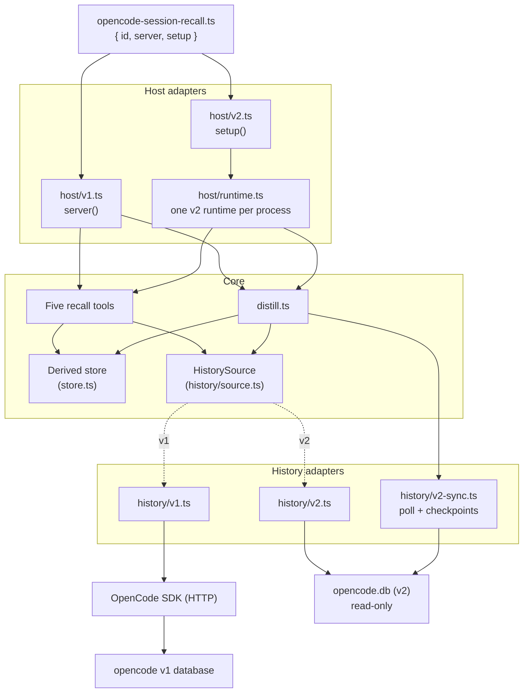
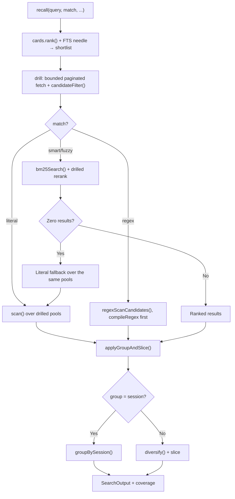
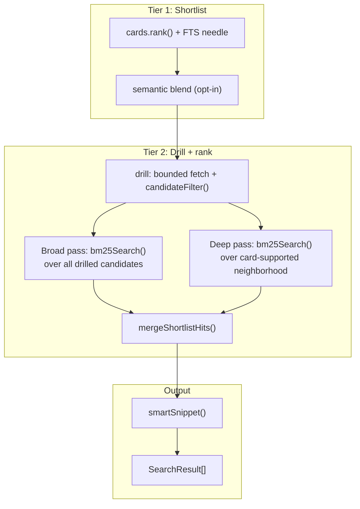
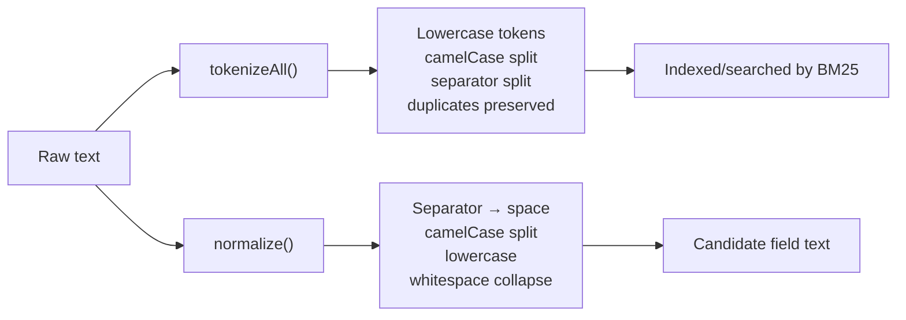
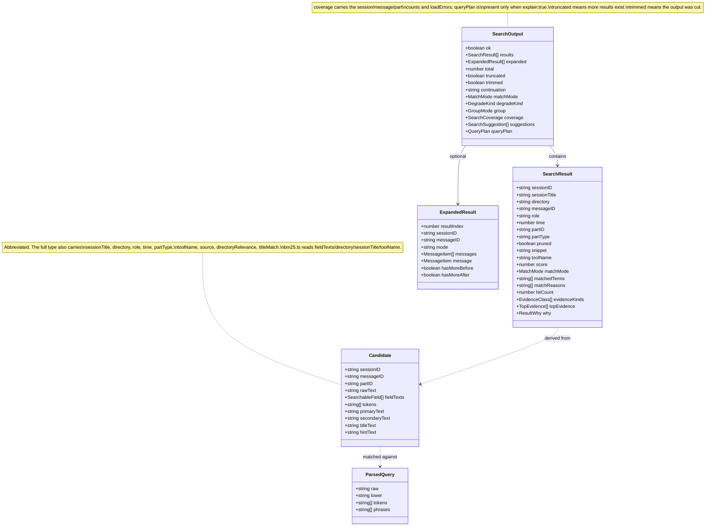

# Contributing to opencode-session-recall

## Development setup

```bash
git clone https://github.com/rmk40/opencode-session-recall.git
cd opencode-session-recall
npm install
npm run typecheck    # type-check without emitting
npm run compile      # build with tsup + tsc declarations
npm run dev          # run in opencode plugin dev mode
```

### Requirements

- Node.js 22.5+ (the tests use `node:sqlite`)
- TypeScript 6+
- An [OpenCode](https://github.com/opencode-ai/opencode) installation (for live testing)

### Build

The project uses `tsup` for bundling and `tsc` for declaration files. ESM-only (`"type": "module"`). Strict TypeScript with `noUncheckedIndexedAccess`.

```bash
npm run typecheck && npm run compile
```

Output goes to `dist/`. The single entry point is `src/opencode-session-recall.ts`; the root `server.js` re-exports it for local-directory installs on opencode v2.

## Architecture

### High-level overview



One package serves both opencode generations. opencode v1 (`@opencode-ai/plugin` 1.3.4+) calls `server()` in `src/host/v1.ts`; opencode v2 (`@opencode/plugin` 2.0.x) calls `setup()` in `src/host/v2.ts`, which stays inert unless a capability probe finds a real v2 context (v1.18 also calls `setup`, with a partial one). Both register the same five tools, plus hooks (see [Invocation hooks](#invocation-hooks)).

The tools, drill, and distiller read opencode history only through the host-neutral `HistorySource` interface (`src/history/source.ts`): session listings and lookups, children, bounded message pages, and single messages. On v1 the implementation is `src/history/v1.ts`, loaded lazily by `src/host/v1.ts`, which calls the OpenCode SDK over the host's in-process transport. Only `src/host/v1.ts` may load it, and only it may import SDK values (both enforced by ESLint). On v2 the plugin API cannot page history, so `src/history/v2.ts` reads opencode's `opencode.db` directly through a read-only handle and projects its rows into the same read model (`src/history/v2-project.ts`). That includes the `session_part` rows opencode 2.4 stores an assistant's content in, merged as part rows by ordinal followed by inline content. A message too large for one read comes back `partial`. `getMessage` with a part ordinal reads the rest. Listings can filter archived sessions and report `truncated`. v2 listings can also page by immutable session id (`order: "id"`, `after`).

On v2, everything stateful lives in one process runtime (`src/host/runtime.ts`, `src/host/v2-runtime.ts`) that every location's `setup` attaches to: the store, the distiller, the card runtime and the `opencode.db` handle exist once per process, and each instance gets a history facade bound to its own project. The facades share one drift state (`HistorySource.history()`), which counts what reads could not project and backs `coverage.history`. v2 events are only a latency hint there; `src/history/v2-sync.ts` keeps the store fresh by polling `opencode.db` and checkpointing each session's tail. The v2 distiller also carries a projector generation (`V2_PROJECTOR_GEN`), which turns on a repair sweep that rebuilds cards built under an older projection and a range check that finds part-only changes no poll sees. On v1 neither runs. When `opencode.db` cannot be read, the source reports it (`unavailable`), `recall` answers from the cards through `src/card-drill.ts`, and responses carry `coverage.source`.

Every tool returns through the serializer in `src/output.ts`, which keeps a result within OpenCode's output limits and marks a cut result `trimmed` with a `continuation` the tool accepts back as `cursor`. Both hosts pass each result through `boundResult` as a backstop.

### Module map

| Module                       | Purpose                                                                                                                                                                                                                                                                                                                                                                                                                                                                                                                                                                                |
| ---------------------------- | -------------------------------------------------------------------------------------------------------------------------------------------------------------------------------------------------------------------------------------------------------------------------------------------------------------------------------------------------------------------------------------------------------------------------------------------------------------------------------------------------------------------------------------------------------------------------------------- |
| `opencode-session-recall.ts` | Package entry: the one default export `{ id, server, setup }` both hosts load (v1 calls `server`, v2 calls `setup`)                                                                                                                                                                                                                                                                                                                                                                                                                                                                    |
| `host/v1.ts`                 | The v1 host entry (`server`). Parses options, lazily loads the v1 history source, builds the shared fetch gate, card store, drill, and distiller; registers tools and hooks. Every tool result passes through `boundResult` and a rejection becomes a bounded error result                                                                                                                                                                                                                                                                                                             |
| `host/v2.ts`                 | The v2 host entry (`setup`). A capability probe keeps it inert under v1.18's partial-context `setup` call; otherwise it attaches to the process runtime and registers the five direct tools and the `context` hook (`primary`, nudge). Every tool result passes through `boundResult`                                                                                                                                                                                                                                                                                                  |
| `host/registry.ts`           | The process-wide registry on `globalThis` (shared across module re-evaluations and between `server` and `setup`)                                                                                                                                                                                                                                                                                                                                                                                                                                                                       |
| `host/runtime.ts`            | The reference-counted v2 runtime registry: one runtime per build, mode, store and source; deferred creation, retirement handoff, bounded detach, event-id dedupe                                                                                                                                                                                                                                                                                                                                                                                                                       |
| `host/v2-runtime.ts`         | What a v2 runtime holds: the read-only `opencode.db` handle and per-project history facades sharing one drift state, the store, gate, cards, drill, distiller (with the `opencode.db` sync, id-paged discovery that includes archived sessions and `V2_PROJECTOR_GEN`) and event mapping. `discoverSessions` is the discovery loop, with a macrotask pause between pages                                                                                                                                                                                                               |
| `host/v2-tools.ts`           | The five tools assembled over a v2 runtime (or a starting stand-in) and converted to v2 tool definitions                                                                                                                                                                                                                                                                                                                                                                                                                                                                               |
| `host/tool-io.ts`            | Adapts the v2 tool context to the tools' v1 `ToolContext` (location as directory, no-op titles)                                                                                                                                                                                                                                                                                                                                                                                                                                                                                        |
| `build-id.ts`                | `BUILD_ID`, a per-build `tsup` define that keys the v2 runtime registry                                                                                                                                                                                                                                                                                                                                                                                                                                                                                                                |
| `host/opencode-v2-types.ts`  | Vendored v2 plugin types, checked against `@opencode/plugin` by `test/host-v2-types.test.ts`                                                                                                                                                                                                                                                                                                                                                                                                                                                                                           |
| `search.ts`                  | `recall` tool. Orchestrates the tiers (cards → slim FTS → drill), deep-sweep mode, literal/regex/smart paths, filters, expansion, grouping. Excludes the current session by default (its whole family with `excludeFamily`), orders relatives by family diversity and names excluded sessions that matched. Reports the drill's message counts, its stop reasons, `coverage.history`, `coverage.cards.pending` and `coverage.toolNames`. Returns through `output.ts` with expansions trimmed before results                                                                            |
| `store.ts`                   | SQLite card + slim-FTS store: schema v5, additive migrations (v1→v2→v3→v4→v5)/rebuild, host fence (`store_host`, `source_db`), per-session transactional replace with write suppression, revision accounting (`cards_rev`, `write_rev`, `cards_stamped`, `cards_deleted`), projector-generation guard, stale and repair-pending cards, range hashes, tail writes (`replaceSessionTail`) and settled bases, keyset card, vector and rollup pages (`cardsPage`, `cardVectorsPage`, `rollupFieldsPage`, `familyPage`), FTS query, card-vector persistence with per-row generations, lease |
| `distill.ts`                 | The distiller: human-layer extractor, card builder, resumable cold pass, and incremental updates driven by host-neutral `DistillSignal`s. It reads metadata again after a distill that a metadata patch raced, recomputes family rollups a page at a time and yields between session writes. With a projector generation (v2) it also re-reads only a running tail, runs the loss guard, the repair sweep and the range check and records range hashes with every index write                                                                                                          |
| `history/source.ts`          | The `HistorySource` seam: the one interface the core reads opencode history through (listings in recency or id order with `archived` and `truncated`, lookups, children, bounded pages, optional oldest-first pages, single messages with part continuations), the shared drift state (`HistoryDrift`, `HistoryReadCounts`), plus `assertBoundedLimit`                                                                                                                                                                                                                                 |
| `history/model.ts`           | Host-neutral history shapes (`HistoryMessage` with its `partial`, `HistorySession`) and `compareMessages` ordering                                                                                                                                                                                                                                                                                                                                                                                                                                                                     |
| `history/v1.ts`              | The v1 `HistorySource` over the HTTP SDK: builds the scoped and unscoped clients and owns `fetchMessagePage()`, the only `session.messages` call. Loaded only by `host/v1.ts`                                                                                                                                                                                                                                                                                                                                                                                                          |
| `history/v1-events.ts`       | Maps v1 bus events to the distiller's host-neutral `DistillSignal`s                                                                                                                                                                                                                                                                                                                                                                                                                                                                                                                    |
| `history/v2-events.ts`       | Maps v2 bus events to `DistillSignal`s (step throttle, metadata patches); a latency hint only                                                                                                                                                                                                                                                                                                                                                                                                                                                                                          |
| `history/v2-sync.ts`         | The v2 distiller's freshness from `opencode.db`: tail checkpoints with part state, unsettled tails and their settled boundary (the `tail` change), the message poll and `session_v2` scan, deletion checks, range digests and which sessions have part rows                                                                                                                                                                                                                                                                                                                            |
| `history/v2.ts`              | The v2 `HistorySource` over a read-only `opencode.db` handle: the schema check (optional `session_part` capability, tested migrations, unknown tables), id-paged listings, lookups, pages bounded by bytes and part rows over `session_message` and `session_part` with placeholders for rows it will not load and `partial` messages, oldest-first pages with their own `v2a:` cursors, part-ordinal continuations capped by `maxBytes`, per-user agent/model attribution                                                                                                             |
| `history/v2-project.ts`      | Projects v2 `session_v2`, `session_message` and `session_part` rows into the host-neutral read model (part rows by ordinal, then inline content) and defines `V2_PROJECTOR_GEN`                                                                                                                                                                                                                                                                                                                                                                                                        |
| `history/v2-path.ts`         | Resolves the v2 `opencode.db` path the way opencode does (`OPENCODE_DB`, build channel, `XDG_DATA_HOME`), or the `opencodeDbPath` option                                                                                                                                                                                                                                                                                                                                                                                                                                               |
| `card-drill.ts`              | A drill that reads nothing: builds each target session's pool from its card, used by `recall` when the history source is unavailable                                                                                                                                                                                                                                                                                                                                                                                                                                                   |
| `host/opencode-v1-types.ts`  | Vendored v1 plugin types (`Hooks`, `ToolContext`, `PluginInput`, and the rest), checked against `@opencode-ai/plugin` by `test/host-v1-types.test.ts`                                                                                                                                                                                                                                                                                                                                                                                                                                  |
| `tool-def.ts`                | Local `tool()` drop-in with `tool.schema` (zod), so the bundle imports no host package at runtime                                                                                                                                                                                                                                                                                                                                                                                                                                                                                      |
| `options.ts`                 | `parseOptions()`: pure plugin option parsing shared by hosts; returns warnings instead of logging                                                                                                                                                                                                                                                                                                                                                                                                                                                                                      |
| `log.ts`                     | Plugin logging through a host-chosen sink (`consoleSink` on v1); adds the `[recall]` prefix and swallows sink failures                                                                                                                                                                                                                                                                                                                                                                                                                                                                 |
| `summarize.ts`               | Opt-in Path B summarizer: a worker-session that batches card digests through a cheap model, content-hash gated, driven by the distiller                                                                                                                                                                                                                                                                                                                                                                                                                                                |
| `embedding-text.ts`          | `embeddingTextOf()`: the natural-language projection embedded for each card, plus the persisted-vector representation stamp                                                                                                                                                                                                                                                                                                                                                                                                                                                            |
| `cards.ts`                   | Tier-1 card runtime: a card map refreshed from the store's revision counters and a MiniSearch index over card fields (incl. `nl_summary`) updated in place, both loaded and built in time-sliced jobs that `ready()` awaits. Metadata filters, session and family exclusion, excluded-match and pending counts, vector provenance, optional semantic blend + rescue. `storeCardSource()` builds the store-backed source                                                                                                                                                                |
| `drill.ts`                   | Tier-2 bounded drill and the deep sweep: paginated fetch, budgets, the drill cache of fetched pages and point lookups, per-session read counts and stop reasons, deep continuation cursor                                                                                                                                                                                                                                                                                                                                                                                              |
| `rerank.ts`                  | Two-stage drilled rerank (`mergeShortlistHits`): broad pass plus a shortlist-local deep pass over drilled candidates                                                                                                                                                                                                                                                                                                                                                                                                                                                                   |
| `fetch-gate.ts`              | Shared semaphore every history read passes through; foreground queries have priority over the background distiller                                                                                                                                                                                                                                                                                                                                                                                                                                                                     |
| `fetch-window.ts`            | Bounded newest-first message-window fetch for `recall_context` and inline expansion                                                                                                                                                                                                                                                                                                                                                                                                                                                                                                    |
| `sqlite.ts`                  | Runtime-detected driver adapter: `bun:sqlite`, else `node:sqlite`, else null (degraded); `openSqliteReadOnly` returns the get/all/close-only handle v2 reads `opencode.db` through                                                                                                                                                                                                                                                                                                                                                                                                     |
| `corpus.ts`                  | Session-digest derivation (`buildSessionDigest`) and the embedder surface the card runtime consumes (`CandidateEmbedder`)                                                                                                                                                                                                                                                                                                                                                                                                                                                              |
| `extract.ts`                 | Text extraction from message parts. `searchableFields()`, `matches()`, `evidenceClassFor()`, `isSelfTool()`, `isSummarizerTitle()`                                                                                                                                                                                                                                                                                                                                                                                                                                                     |
| `types.ts`                   | Shared types and `Limits`/`DEFAULTS`; defensive coercers (`coerceEnum`/`coerceInt`)                                                                                                                                                                                                                                                                                                                                                                                                                                                                                                    |
| `sessions.ts`                | `recall_sessions` tool (card-backed enrichment, since/until, live `parentID` children lookup paged by id through `listAllChildren`, staleness fallback, pages past `limit` through cursors that refuse a changed listing)                                                                                                                                                                                                                                                                                                                                                              |
| `get.ts`                     | `recall_get` tool (output continuations that read from the row of the part the output stopped in, plus part continuations for a message a v2 read cut short)                                                                                                                                                                                                                                                                                                                                                                                                                           |
| `context.ts`                 | `recall_context` tool (output continuations)                                                                                                                                                                                                                                                                                                                                                                                                                                                                                                                                           |
| `messages.ts`                | `recall_messages` tool (newest or oldest first, scanning bounded pages until `limit` messages match under its scan, page and output budgets, with `rc.` cursors that resume right after the last message read or inside a trimmed output, whatever the next call's filters and limit)                                                                                                                                                                                                                                                                                                  |
| `output.ts`                  | The tool output serializer. `writeOutput` writes the header fields, then one record per line within 40 KiB and 1,900 lines. When it stops early it sets `trimmed` and a per-tool `rc.` continuation. Also `writeError`, the continuation codecs and `boundResult`, the hosts' backstop at OpenCode's own limits                                                                                                                                                                                                                                                                        |
| `hash.ts`                    | `cyrb53`, the pure-JS 53-bit string hash for change detection (summary hashes, range hashes, checkpoint fingerprints and continuation fingerprints)                                                                                                                                                                                                                                                                                                                                                                                                                                    |
| `normalize.ts`               | Tokenizers/normalizer: `tokenizeAll()` (dup-preserving, for BM25) and `tokenize()` (deduped)                                                                                                                                                                                                                                                                                                                                                                                                                                                                                           |
| `query.ts`                   | Query parsing: `parseQuery()` → `ParsedQuery` with raw, lower, tokens, phrases, codeTokens                                                                                                                                                                                                                                                                                                                                                                                                                                                                                             |
| `candidates.ts`              | Candidate construction over drilled messages; `candidateFilter()` query-time filter predicate; `toolName` alias groups and the closest-name search                                                                                                                                                                                                                                                                                                                                                                                                                                     |
| `digest.ts`                  | Digest-token rules (`isDigestToken`, stopwords) shared by the distiller and session digests                                                                                                                                                                                                                                                                                                                                                                                                                                                                                            |
| `bm25.ts`                    | BM25 relevance ranking (MiniSearch) with structural boosts/penalties, applied within drilled sessions                                                                                                                                                                                                                                                                                                                                                                                                                                                                                  |
| `node-import.ts`             | Dynamic `node:fs`/`node:path`/`node:os` loaders, so `src/` stays free of Node type deps                                                                                                                                                                                                                                                                                                                                                                                                                                                                                                |
| `semantic/embedder.ts`       | Opt-in static-embedding model: download, load, embed (Node builtins only through `node-import.ts` loaders)                                                                                                                                                                                                                                                                                                                                                                                                                                                                             |
| `semantic/similarity.ts`     | Brute-force cosine similarity over card embeddings                                                                                                                                                                                                                                                                                                                                                                                                                                                                                                                                     |
| `regex.ts`                   | `regex` match mode: pattern compile, bounded scan, match snippet                                                                                                                                                                                                                                                                                                                                                                                                                                                                                                                       |
| `route.ts`                   | Query-shape classification (`looksLikeRegex`, `classifyQuery`) that drives mode suggestions                                                                                                                                                                                                                                                                                                                                                                                                                                                                                            |
| `snippet.ts`                 | Token-density sliding window snippet selection                                                                                                                                                                                                                                                                                                                                                                                                                                                                                                                                         |
| `hooks/system-nudge.ts`      | `nudge` option: system-prompt reminder to use recall                                                                                                                                                                                                                                                                                                                                                                                                                                                                                                                                   |
| `hooks/card-recall.ts`       | Shared zero-fetch card query (`cardRecall`) used by both proactive hooks. It waits for the card index before it ranks                                                                                                                                                                                                                                                                                                                                                                                                                                                                  |
| `hooks/auto-recall.ts`       | `autoRecall` option: cue-gated card-tier recall on `chat.message`, injects cited hits                                                                                                                                                                                                                                                                                                                                                                                                                                                                                                  |
| `hooks/compaction-recall.ts` | `compactionRecall` option: preserves the session's own card into the compaction summary                                                                                                                                                                                                                                                                                                                                                                                                                                                                                                |
| `hooks/part-id.ts`           | Generates opencode-compatible ascending `prt_` part IDs for injected synthetic parts                                                                                                                                                                                                                                                                                                                                                                                                                                                                                                   |

### Search paths

Every search resolves a shortlist of sessions from the card store (tier 1) plus the slim FTS index (tier 1.5), then drills those sessions through the history source under budgets (tier 2) and runs the match path over the drilled candidates. Query-time filters (`type`, `role`, `before`/`after`, `toolName`) are applied by the pure predicate `candidateFilter()`, built once per query, on each drilled session's candidates. `deep: true` replaces tier-1 selection with an exhaustive sweep of an explicitly scoped session set (see [Deep mode](#deep-mode)). From there, three distinct execution paths, selected by `match`:



**Literal path** (`match: "literal"`, the default): `scan()` iterates the drilled candidates' field texts (`searchableFields()` output, built when the drill fetches each session) → `matches()` (case-insensitive `includes`). Drilled slices include tool outputs, so literal covers outputs within the drilled sessions. Stops once enough results are collected (the part path over-collects for diversity; grouped mode scans broadly). Available for all scopes.

**Regex path** (`match: "regex"`): The pattern is compiled once with `compileRegex()` up front, so an invalid pattern is a hard error before any scanning. `regexScanCandidates()` mirrors the literal scanner over the same drilled candidates but matches with the compiled `RegExp` and builds snippets via `regexSnippet()`. Bypasses BM25. Field text is length-capped per match; there is no per-match timeout (see `regex.ts` header).

**Smart/fuzzy path** (`match: "smart"` or `"fuzzy"`): `bm25Search()` ranks the drilled candidates, and the two-stage drilled rerank (`rerank.ts`) re-scores the card-supported neighborhood under its own term statistics (see [Smart/fuzzy pipeline](#smartfuzzy-pipeline)). Returns all ranked results; the caller slices and optionally groups. Falls back to the literal path over the same drilled pools if it finds nothing, so smart/fuzzy results that came from the fallback carry literal semantics (no `score`/`matchedTerms`).

**Session grouping** (`group: "session"`): `groupBySession()` collapses results to one entry per session, plus `hitCount`, `evidenceKinds`, and up to two `topEvidence` snippets of other evidence classes. The representative is chosen by evidence-class priority (`CLASS_PRIORITY`: human-text and tool-input before file-read, web-fetch, and skill-definition) among the tracked hits within `REPRESENTATIVE_TOLERANCE` of the session's best score, so a session isn't represented by its skill payload when a command hit scores nearly as well. In part mode, `diversify()` caps how many hits a single session contributes to the initial fill, and a final `capAndSlice()` pass caps generated reference material per class (`CLASS_CAPS`: one skill-definition, two file-read, two web-fetch) and guarantees one tool-input hit for command-like queries.

**Expansion** (`expand: "context"` or `"message"`): After filtering, grouping, and slicing, `expandSearchResults()` fetches messages on demand for only the expanded sessions and attaches an `expanded` array for the first `expandResults` final results. Context expansion marks the matched message with `center: true` and includes `hasMoreBefore` / `hasMoreAfter`. Each part is capped at `MAX_EXPANDED_PART_CHARS` (6,000) within the total budget; when the matched part itself is truncated, `truncatePreservingMatch()` (`snippet.ts`) keeps the head plus a window around the match instead of head-slicing the match away.

### Tool output

OpenCode passes a tool result to the model whole only up to 2,000 lines and 50 KiB of UTF-8 (`HOST_OUTPUT_LIMIT` in `output.ts`). Past either it cuts at a line boundary. Every tool therefore builds its text with `writeOutput()`, which writes one valid JSON document within `OUTPUT_BUDGET` (40 KiB, 1,900 lines). The header line comes first (`ok`, then `trimmed` and `continuation` when set, then the tool's own fields), followed by each record array with one record per line. When the records do not all fit, it stops at the first one that does not, shows as much of it as fits (down to a text field offset inside a part, marked `cutAt`) and sets `trimmed: true` with a `continuation`. A continuation is `rc.` followed by base64url JSON naming its tool and the position of the first omitted item. The tool takes it back as `cursor`, rebuilds the same output and resumes there, marking a part resumed mid-field with `resumedAt`. When the rebuilt output no longer matches what the continuation recorded, the tool refuses the cursor instead of skipping or repeating records. `recall` puts results before expansions, so expansions are trimmed first. Errors go through `writeError()`, which caps the message.

Both hosts run `boundResult()` over every result as a backstop. A result over `HOST_OUTPUT_LIMIT` is replaced with a small `{ ok: false, trimmed: true, error }` object. On v1 a rejected `execute` becomes the same kind of bounded error result.

### Invocation hooks

Besides the five tools, the plugin optionally registers hooks so the agent uses recall proactively, gated by plugin options. The v1 hooks are wired in `host/v1.ts`, the v2 hook in `host/v2.ts`. Each hook is fully wrapped in `try/catch`: OpenCode runs hooks through `Effect.promise`, where a thrown hook becomes a fatal defect, so the hooks must never throw.

| Host | Hook                                 | Option (default)                 | Module                       | Behavior                                                                                                  |
| ---- | ------------------------------------ | -------------------------------- | ---------------------------- | --------------------------------------------------------------------------------------------------------- |
| v1   | `experimental.chat.system.transform` | `nudge` (on)                     | `hooks/system-nudge.ts`      | Pushes one reminder string onto `output.system`; idempotent via a sentinel; guards entry types            |
| v1   | `chat.message`                       | `autoRecall` (off)               | `hooks/auto-recall.ts`       | Cue-gated card-tier recall; injects a cited synthetic text part into `output.parts`                       |
| v1   | `experimental.session.compacting`    | `compactionRecall` (off)         | `hooks/compaction-recall.ts` | Reads the session's own distilled card; appends one cited block to `output.context` (never sets `prompt`) |
| v2   | `session.hook("context")`            | `nudge` (on), `primary` (on)     | `host/v2.ts`                 | Removes the recall tools for a child session (`primary`); otherwise adds the nudge once per request       |
| v2   | none yet                             | `autoRecall`, `compactionRecall` | none                         | Deferred on v2: enabling either logs one line and registers nothing                                       |

Both proactive hooks query the card tier directly through `cardRecall()` (`hooks/card-recall.ts`) and make zero message fetches. `cardRecall()` first waits for the card index (`cards.ready({ index: true })`), since its hits are injected without a drill and must come from every card's current content. `autoRecall` ranks cards for a cue-derived query (excluding the current session's family) and injects the top few as a cited block; `compactionRecall` reads the current session's own card and preserves its durable fields (focus, outcome, errors, identifiers, files). There is no search-tool instance, no wall-clock timeout, and no shared cache to warm, so the `prewarm` option does nothing. It is kept so existing configs still load. `autoRecall` injects a `synthetic: true` text part carrying a real `prt_` id from `hooks/part-id.ts`, because the hook fires after OpenCode has already assigned ids to the message's other parts.

### Smart/fuzzy pipeline



#### Stage 1: Shortlist and drill (`cards.ts`, `drill.ts`, `candidates.ts`)

Tier 1 ranks the in-memory cards (`cards.rank()`), tier 1.5 adds any sessions whose slim FTS rows carry an anchor the card missed, and the two merge into a shortlist capped at `drillSessions` (default 12). Tier 2 (`drill.ts`) fetches those sessions in bounded newest-first pages through `fetchMessagePage()`, truncating each part to `MAX_CHARS_PER_CANDIDATE` immediately, and stops paging at the per-session budget or once pages stop matching any query anchor. For each drilled session, `buildCandidates()` scans messages newest-first: `searchableFields()` extracts each part's field texts (joined as `rawText`, tool outputs included), `tokenize()` produces the deduplicated token set, and `populateNormalized()` fills the indexed fields (camelCase splitting, separator → space, lowercase, whitespace collapse). Query-time filters (`type`, `role`, `before`/`after`, `toolName`) are the pure predicate `candidateFilter()`, built once per query and applied to each drilled session's candidates.

The card runtime (`cards.ts`) keeps a map of every card and a MiniSearch index over card fields in each process. At most every 5 seconds it applies the cards stamped since its last refresh (`cardsSince`) to the map. It updates the index card by card, removing each old document and adding the new one. A cold start, a store reset and an older build's unstamped writes load every card in keyset pages. A large change rebuilds the index in time slices, so `recall` awaits `cards.ready({ index: true })` before tier-1 ranking. `rank()` leaves out the cards the index has yet to take and counts them for `coverage.cards.pending`. A search of one session or of a named list reads only the map. [AGENTS.md](AGENTS.md) describes the job slots, what triggers a full load or build and when a stored vector is reused.

Card ranking, the slim-index lookup and the deep listing exclude the current session, or its whole family under `excludeFamily`. Without a time bound, `familyDiversity()` moves a relative whose best evidence is its delegated prompt below the best result from outside the family and holds relatives to two of the first five results. `capFamilySlots()` holds them to `familyDrillSlots()` drill slots, a third of the shortlist and never fewer than two. A search of one session or of a named list skips both.

The drill budgets (all plugin options, defaults from `DEFAULTS`):

| Limit                     | Default    | Purpose                                        |
| ------------------------- | ---------- | ---------------------------------------------- |
| `drillSessions`           | 12         | Sessions a query drills into                   |
| `drillPageMessages`       | 25         | Messages per untargeted drill page             |
| `drillCharsPerSession`    | 1,500,000  | Retained-chars budget per drilled session      |
| `drillCharsPerQuery`      | 20,000,000 | Retained-chars budget across one drill         |
| `deepCharsPerQuery`       | 30,000,000 | Retained-chars budget for one deep sweep       |
| `cacheMaxChars`           | 24,000,000 | Drill cache budget (keeps repeat queries warm) |
| `MAX_CHARS_PER_CANDIDATE` | 20,000     | Truncate very long tool outputs per candidate  |

The drill cache keeps, per session, the newest-first pages a drill fetched (with the cursors they returned) and the messages it looked up by id, so repeat and refined queries stay warm. Each query replays its own paging loop over the cache and fetches only what the cache lacks. Its candidates come from exactly the slice a fresh fetch would return, whatever queries ran before it. An entry is keyed by the session's `time.updated` plus its card's `writeRev`, so a re-index that leaves the session timestamp unchanged still drops it. A target with no card revision is served from the cache for at most 30 seconds. Sessions are evicted least recently used while the cache is over `cacheMaxChars` or over 50,000 cached objects (entries, pages, messages and lookups). Eviction only ever costs latency, never results, since an evicted session is re-fetched when drilled again. Each drilled session's `digestText` (the first user message's head plus its characteristic action vocabulary, with no credit for file reads or skill payloads) is stamped onto its candidates for ranking. The drill embeds nothing itself; the semantic blend is a card-tier concern only (Stage 3).

#### Stage 2: BM25 ranking, broad and deep (`bm25.ts`, `rerank.ts`)

A fresh in-memory MiniSearch index is built per query over the drilled candidates and discarded after (the drilled candidates live in the drill LRU; the index does not). MiniSearch provides BM25+ scoring, which weights rare terms (IDF) and normalizes for document length.

The index tokenizes with `tokenizeAll()` (the duplicate-preserving tokenizer, so term frequency stays meaningful). Field boosts:

| Field           | Boost | Source                         |
| --------------- | ----- | ------------------------------ |
| `primaryText`   | 2     | Normalized message/tool text   |
| `secondaryText` | 0.6   | Normalized project directory   |
| `digestText`    | 0.4   | Content-derived session digest |
| `titleText`     | 0.3   | Normalized session title       |
| `hintText`      | 0.15  | Normalized tool name           |

Search options: `combineWith: "OR"`, `prefix` for terms > 3 chars, and `fuzzy` for terms ≥ 4 chars (edit-distance fraction 0.2 for smart, 0.3 for fuzzy, capped by `maxFuzzy: 6`).

The ranking runs as two passes over the drilled pool (`rerank.ts`). The broad pass scores every drilled candidate; the deep pass re-scores only the card-supported neighborhood (the sessions tier 1's `cards.rank()` shortlisted) over a **second index built only from those sessions' candidates**. The second build is required, not an optimization choice, because MiniSearch fixes IDF at index-build time, so only a neighborhood-only index gives the deep pass shortlist-local term statistics. `mergeShortlistHits()` anchors each deep hit to its own session's broad-pass ceiling, applies `SHORTLIST_MULT` (×1.1) exactly once, and dedupes by `partID` keeping the higher score; a session whose broad hits were all dropped by the relative floor re-enters at floor level. Both passes stay inside the drilled pool.

BM25 scores are normalized to 0..1 relative to the top hit, then adjusted by **multiplicative** structural boosts/penalties:

| Signal             | Multiplier | Condition                                                                    |
| ------------------ | ---------- | ---------------------------------------------------------------------------- |
| Exact phrase       | ×1.15      | Quoted phrase found verbatim in raw text                                     |
| Session digest     | ×1.15      | At least half the query tokens appear in the session digest                  |
| Exact code token   | ×1.12      | A code-like query token (compound, camelCase, CONSTANT) verbatim in raw text |
| All tokens matched | ×1.10      | Every query token present (exact or fuzzy)                                   |
| Tool input         | ×1.10      | Evidence class `tool-input` (matched in command/cwd/toolName fields)         |
| Reasoning part     | ×1.05      | Part type is `reasoning`                                                     |
| Error text         | ×1.05      | Tool output contains error-like patterns                                     |
| User role          | ×1.03      | Message authored by user                                                     |
| Recency            | ×1.00–1.05 | Decays linearly over 1 week                                                  |
| Weak single fuzzy  | ×0.90      | Single match, relative score < 0.7                                           |
| File read          | ×0.90      | Evidence class `file-read` (tool name suffix-matches `read`)                 |
| Skill definition   | ×0.85      | Evidence class `skill-definition` (tool name suffix-matches `skill`)         |
| Web fetch          | ×0.85      | Evidence class `web-fetch` (output match on fetch/scrape/search-shaped tool) |
| Poor coverage      | ×0.92      | < 50% of query tokens matched                                                |

The evidence class comes from `evidenceClassFor()` in `extract.ts`, derived deterministically from part type, tool name, and matched fields; it is also returned on every result as `why.evidenceClass`. Internal scores are deliberately **unclamped** — clamping per hit would erase every positive boost at the relative top — and are clamped to 0–1 once at output in `rankedToSearchResults()`.

A relative score floor (`MIN_RELATIVE_SCORE`) drops trailing noise from OR-combined weak single-term matches, but never drops the only/best hit. Results sort by score, then recency, then `partID` for deterministic ties. When `explain: true`, each adjustment is recorded in `matchReasons`, and the output carries `queryPlan` (`variants` is the capability inventory, `selected` records what actually ran).

Quoted phrases are soft signals, not hard constraints: `parseQuery()` turns them into ordinary tokens for BM25, and the exact-phrase multiplier rewards documents whose raw text contains the verbatim phrase.

#### Stage 3: Semantic blend (`semantic/`, opt-in, card tier)

Off unless the `semantic` plugin option is set, and it operates at the **card tier**, not the part level. `cards.ts` embeds each card's text once and blends the cosine similarity between the query vector and each card vector into that card's lexical score (weighted by `semanticWeight`). It is a mild reorderer, not a vocabulary-gap solver: the embedded text is a natural-language projection of the card (`embedding-text.ts`, identifiers split into words), not raw fields, but the default model is small, so real-corpus testing found the blend only nudges borderline paraphrases at the margin, and rephrasing the query stays the reliable path when wording diverges. Card vectors persist lazily to the `card.embedding` column, stamped in `meta.semantic_model` with both the model id and the embedding representation generation (`EMBED_REPRESENTATION`), and each row also carries its own `embedding_gen`; a process reuses a stored vector only when it was read under its own model's stamp with no vector write landing during the read, its generation is current and it belongs to the card version the process holds. A running process also keeps the vector it computed for a card until the card's content changes, so a model switch in another process or a full index rebuild re-embeds nothing that is still current. Otherwise it recomputes (a re-distilled card is upserted with a null embedding, so staleness self-heals). A lower-generation writer can never downgrade a higher one, and a change to the representation semantics rides a `SCHEMA_VERSION` bump. Final result ranking stays lexical over the drilled parts, so a session the embedding surfaced but whose drilled parts yield no lexical hit simply drops from the results. Any failure (model missing, embed error) leaves ranking exactly as the lexical path produced it, with one warning while the model is still loading. `semantic/embedder.ts` is the only module allowed to touch Node APIs, exclusively via dynamic `import()`, so non-Node runtimes and disabled installs degrade gracefully.

#### Stage 4: Snippet selection (`snippet.ts`)

`smartSnippet()` finds all positions of query tokens and phrases in the raw text, then uses a sliding window to select the span with the most distinct token matches. The window is centered on the densest cluster.

### Deep mode

Regular search reads tool outputs only within the sessions it drills into, so a needle that lives solely in a tool output of a session nothing else points at is the one thing tiers 1 through 2 cannot serve. `deep: true` is the explicit escape hatch (`drill.deep()`): it resolves an explicitly scoped session set (a `sessions` list, an explicit `sessionID`, or a lower time bound plus a project/directory constraint), sweeps every part of each scoped session including outputs, and ranks with the same match path as a normal query. It runs under `deepCharsPerQuery` and a soft wall-clock budget; when a budget stops it partway, it returns an opaque base64url continuation cursor (`encodeDeepCursor`) that the caller passes back as `deepCursor` to resume exactly where coverage stopped. A resumed cursor is validated defensively: session ids the store doesn't know are dropped with a warning and the resumed set is capped. A global unscoped deep is rejected with guidance. Coverage carries a `deep` block (sessions covered, partial, remaining) and the top-level `nextCursor`.

### Text normalization



- `tokenizeAll()`: duplicate-preserving tokenizer used by the BM25 index and search so term frequency is meaningful.
- `tokenize()`: deduplicated variant used for set-membership checks (matched-term/field detection, query token uniqueness).
- `normalize()`: whitespace-collapsed normalized string used to populate the candidate fields the index reads.

### Dependencies

| Package               | Version | Kind               | Purpose                                                                       |
| --------------------- | ------- | ------------------ | ----------------------------------------------------------------------------- |
| `@opencode-ai/sdk`    | ^1.3.2  | runtime (v1 only)  | OpenCode HTTP client, used only by `src/history/v1.ts`; types elsewhere       |
| `minisearch`          | ^7.2.0  | runtime            | BM25 relevance ranking for smart/fuzzy search                                 |
| `fastest-levenshtein` | ^1.0.16 | runtime            | Edit-distance for matched-term detection                                      |
| `zod`                 | ^4.3.6  | runtime            | Schema validation backing the `tool.schema` builder for tool args             |
| `@opencode-ai/plugin` | >=1.3.4 | optional peer, dev | v1 plugin types; `src/` vendors them, and a test checks the copy against this |
| `@opencode/plugin`    | 2.0.18  | dev only           | v2 plugin types; `src/` vendors them, and a test checks the copy against this |

Nothing in `src/` imports either plugin package (ESLint enforces it), so a v2-only install needs neither.

### Type hierarchy

Key types across the codebase (`types.ts`, `candidates.ts`, `query.ts`):



### Extending

#### Performance gates

`test/perf.test.ts` and `test/perf-v2.test.ts` hold the performance budgets. Machine-dependent wall-clock timing is off by default, so both run only with `RECALL_PERF=1`. The verbose reporter prints the numbers of passing gates:

```bash
RECALL_PERF=1 npx vitest run test/perf.test.ts test/perf-v2.test.ts --reporter=verbose
```

| Gate                                                                               | Budget                                                                                                 |
| ---------------------------------------------------------------------------------- | ------------------------------------------------------------------------------------------------------ |
| Tier-1 card rank over 20 queries on about 4,700 cards                              | p95 under 50 ms                                                                                        |
| Single-session distill plus replace (20 sessions of about 64 parts)                | p50 under 150 ms, the suppressed replace p50 under 50 ms                                               |
| `ftsSearch` over about 50,000 slim-index rows                                      | p95 under 100 ms                                                                                       |
| A drilled smart query end to end on a store of about 100 sessions                  | under 1.5 s                                                                                            |
| Heap after the tier-1 and end-to-end runs                                          | under 150 MB                                                                                           |
| Cold index build of a 12,000-card store (semantic off, on, on with vectors reused) | no code slice over 50 ms, each build under 60 s, heap after the lexical and reused builds under 600 MB |
| 400 changed cards applied through `ready({ index: true })` on that store           | no full load, no code slice over 50 ms, under 3 s in total                                             |
| 24 `recall` searches on that store with card writes between them                   | no full load, card tier p50 under 250 ms, whole search p50 under 1 s                                   |
| v2 cold pass, one poll, `listSessions` and an append of a 4,000-row session        | no code slice over 50 ms                                                                               |
| v2 tail write over a 5,000-row card                                                | no code slice over 50 ms, under 1 s                                                                    |
| v2 repair sweep over 400 stale cards in a 12,000-card store                        | no code slice over 50 ms, under 30 s                                                                   |
| v2 child write and deletion under a 2,400-child root in a 12,000-card store        | no code slice over 50 ms, each under 1 s                                                               |
| v2 paged discovery of 10,501 sessions and of a root's 2,400 children               | no code slice over 50 ms, each under 1 s                                                               |
| v2 range check over a 500-row session, eight times                                 | no code slice over 50 ms, each check under 250 ms                                                      |

The large-store gates build their cards with `perfCorpus()` from `test/perf-helpers.ts`, which draws inventories from a Zipf vocabulary of 20,000 words plus code identifiers, paths and rare id tokens. Slices are measured with `stallProbe()` from the same file. It ticks a 0 ms interval and subtracts the garbage-collection pauses V8 reported inside each gap. Each gate asserts the slice without GC pauses and logs the raw stall and the longest GC pause beside it, along with the load average. A major collection of a heap of a few hundred MB can pause the loop past 50 ms on its own on a loaded machine, so the raw stall is too noisy to assert. The heap ceilings catch the retained memory that lengthens those pauses. Run these when a change touches the store, the card runtime, the distiller or the drill. When one fails, fix the code it names rather than loosen its budget.

When changing ranking, re-run the relevance eval (`test/eval/`), which gates MRR, recall@5 and per-case `expect` clauses (excluded sessions, evidence classes in the top ranks, a session that must rank below another) against `baseline.json` over a labeled corpus of 19 rank-scored cases, plus an honest-miss and a degraded-mode assertion, so regressions fail the build.

#### Tuning ranking

All ranking constants are at the top of `bm25.ts`:

- `EXACT_PHRASE_MULT`, `ALL_TOKENS_MULT`, `REASONING_MULT`, etc. (multiplicative structural boosts)
- Evidence-class multipliers: `TOOL_INPUT_MULT`, `SKILL_DEFINITION_MULT`, `FILE_READ_MULT`
- `EXACT_TOKEN_MULT` rewards verbatim code-like tokens (`ParsedQuery.codeTokens`)
- `DIGEST_MATCH_MULT` fires when at least half the query tokens appear in the session digest
- `RECENCY_WINDOW_MS` controls how fast the recency boost decays
- `MIN_RELATIVE_SCORE` controls how aggressively weak OR-combined matches are dropped
- `fuzzyFor()` controls smart vs. fuzzy edit-distance tolerance

`SHORTLIST_MULT` (the drilled deep-pass lift) lives in `rerank.ts`; the card-tier field boosts and the code-token boost live in `cards.ts`. Note that internal scores are unclamped during ranking and merging; clamp only at output (`rankedToSearchResults()`), or positive boosts at the relative top are silently erased.

#### Adding a new tool

1. Create a new file in `src/` following the pattern in `get.ts` or `context.ts`
2. Export a function that takes the `HistorySource` (plus the fetch gate and limits it needs) and returns a tool built with `tool()` from `tool-def.ts`
3. Return every result through `writeOutput()` or `writeError()` from `output.ts` and accept a defensively coerced `cursor` argument that takes back the tool's own continuation (see [Tool output](#tool-output))
4. Register it for both hosts: in `host/v1.ts`, and in `buildToolSet()` in `host/v2-tools.ts`
5. Add the tool name to the `TOOLS` array in `types.ts`

## Commit conventions

This project follows [Conventional Commits](https://www.conventionalcommits.org/):

```
<type>(scope): <summary>

<body>
```

Types: `feat`, `fix`, `docs`, `refactor`, `perf`, `test`, `chore`

Common scopes: `recall`, `search`, `bm25`, `snippet`, `types`

## License

MIT — see [LICENSE](LICENSE) for details.
